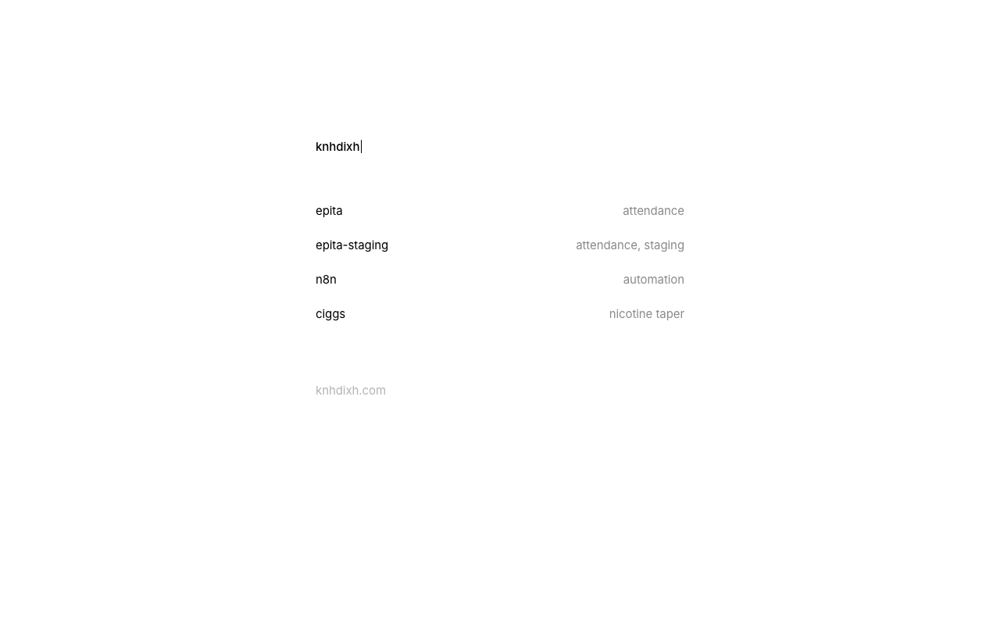

# knhdixh

A minimal homepage for **knhdixh.com**: black on white, a typed heading with a blinking cursor, and a list of everything running on the domain.

**Live:** https://knhdixh.com



## Listings

| Name | Address | What it is |
|---|---|---|
| epita | [epita.knhdixh.com](https://epita.knhdixh.com) | Class attendance tracker |
| epita-staging | [epita-staging.knhdixh.com](https://epita-staging.knhdixh.com) | Staging copy of the above |
| n8n | [n8n.knhdixh.com](https://n8n.knhdixh.com) | Self-hosted n8n automation |
| ciggs | [ciggs.knhdixh.com](https://ciggs.knhdixh.com) | Nicotine taper |

One static HTML file, no build step, no framework. Respects reduced-motion settings.

## Stack

Static assets served by a Cloudflare Worker ([`wrangler.jsonc`](wrangler.jsonc)), on the custom domains `knhdixh.com` and `www.knhdixh.com`.

## Run locally

```bash
npm install
npm run dev        # http://localhost:8787
```

## Deploy

Every push to `main` deploys automatically through Cloudflare Workers Builds (about 30 seconds). To deploy by hand:

```bash
npm run deploy
```

To add a listing, copy an `<li>` in [`public/index.html`](public/index.html).
